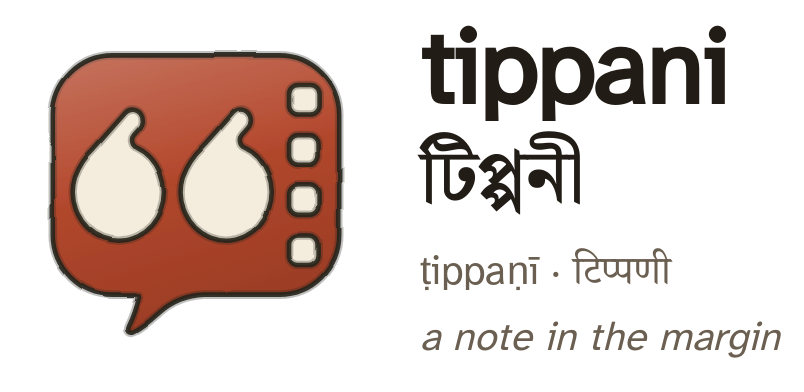

<p align="center">
  <picture>
    <source media="(prefers-color-scheme: dark)" srcset="docs/img/wordmark-dark.png">
    
  </picture>
</p>

<p align="center">
  Tippani for Android: your book highlights, film lines and favourite quotes on your phone.<br>
  It works on its own, and it pairs with your own Tippani server when you have one.
</p>

<p align="center">
  <a href="https://github.com/aaronified/tippani-app/releases/latest"></a>
  <a href="https://github.com/aaronified/tippani-app/releases"></a>
  <a href="https://github.com/aaronified/tippani-app/actions/workflows/ci.yml"></a>
  
  
  <a href="LICENSE"></a>
</p>

<p align="center">
  <a href="https://github.com/aaronified/tippani-app/releases/latest"><strong>Download the app</strong></a> ·
  <a href="https://github.com/aaronified/tippani">The Tippani server</a> ·
  <a href="CHANGELOG.md">What's new</a> ·
  <a href="docs/wiki/Home.md">Wiki</a>
</p>

---

## What it does

- **Keep quotes without a server.** Add books, films, shows and games, and save quotes with the speaker, chapter, tags and colour. Everything is in a
  database on the phone. Import a Kindle `My Clippings` file or a Markdown export, and export your library as Markdown.
- **See who said it.** Each quote shows round portraits for its author, speaker, character and the actor behind the character. Press one to open that
  person's or character's page.
- **Share a picture of a quote.** The same picture the server makes: the quote, who said it, the signature, and the backdrop. Share it, save it, or copy it.
- **Find a quote fast.** Search the whole library, filter by tag, person or colour, sort and group works, and select many quotes at once.
- **Remember them.** A Daily Quiz and Practice on Home, statistics with a calendar of what you saved and recalled, anthologies you can order, annotate and
  practise, and boards.
- **Keep the shelf.** Mark a book, film or game as reading, paused, abandoned or finished, with progress and each time you read it.
- **Read it in English or Bengali.** The words come from the same language files as the server, so a correction there reaches your phone.
- **Use Material You.** The app takes its colours from your wallpaper and has no theme of its own to configure.

### With a Tippani server

Pair the phone with a code from the server's Settings, then your library, tags, people and shelf stay in step both ways. It syncs by itself, never stops
for a conflict, and a delete on one side is checked before it reaches the other. With an admin account the app can also run the server: readers, backups,
sources, metadata, cover search and the people console. The server is optional ([ADR-0003](docs/wiki/ADR-0003-The-App-Works-On-Its-Own.md)).

## Install

1. Open the [latest release](https://github.com/aaronified/tippani-app/releases/latest) on your phone and download `tippani-app-vX.Y.Z.apk`.
2. Open the file and allow your browser to install apps if Android asks.
3. After that the app checks for a newer version when it opens and offers the download itself.

Releases are tagged `app-vX.Y.Z` and cut by a workflow ([Releasing](docs/wiki/Releasing.md)). Every change is listed in the [changelog](CHANGELOG.md).

## Build it

```sh
flutter pub get
flutter run            # a phone or emulator
flutter analyze && flutter test
```

[Developing](docs/wiki/Developing.md) covers the rest: the token system for the app's words, the test support, and previewing every screen without a
phone.

## About the project

- **Android only.** No `ios/` directory will ship ([ADR-0001](docs/wiki/ADR-0001-Android-Only.md)).
- **Flutter**, with the Dart kept platform-neutral.
- **Nothing proprietary.** Text recognition uses Tesseract (Apache-2.0), not Google's ML Kit.
- **Plan and decisions.** [docs/wiki/Plan.md](docs/wiki/Plan.md) says what the app does and why; each decision has its own page, listed in
  [ADR-Index.md](docs/wiki/ADR-Index.md).
- **Server work the app needs** is filed as issues on [Tippani](https://github.com/aaronified/tippani/issues); this repository's issues are the app's.

## Licence

[GPL-3.0](LICENSE). Tippani itself is MIT.
